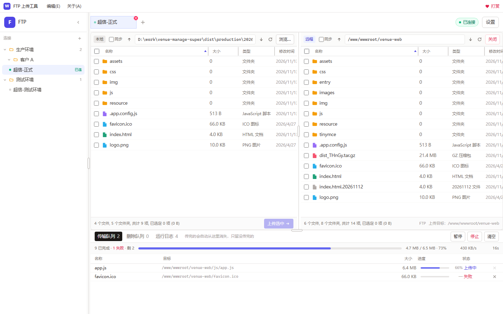

# ftpgo

按「每秒文件个数」限速的 FTP / FTPS / SFTP 桌面传输工具。Go 内核 + Wails（React / TypeScript）界面，另有共用同一套传输内核的命令行版本。

## 主要特点

- **按文件数限速**：令牌桶控制每秒最多启动几个文件，失败重试同样占配额，适合服务端写入限频与海量小文件场景。
- **双栏浏览**：本地与远程并排，支持单选、Ctrl/Cmd 多选、Shift 连选与全选。
- **账号档案**：服务器、协议、目录、限速、并发、重试、断点续传和排除规则随账号保存，支持分组。
- **断点续传**：`.part` 临时文件 + 原子改名；暂停不启动新文件，停止后可从偏移继续。
- **FTP / FTPS / SFTP**：SFTP 支持私钥登录与主机密钥首次信任，证书与主机密钥策略相互隔离。
- **远程管理**：删除、单文件下载、解压、服务端打包、chmod；按服务端能力自动置灰，命令走白名单模板。
- **自动更新**：启动静默检查，支持手动检查；下载后校验 SHA256，确认无活跃传输任务后替换并重启。
- **命令行版**：上传、下载、远程操作均可脚本化，与 GUI 共用内核。

## 下载

到 [Releases](https://github.com/xiaotuni/ftp-go/releases) 下载最新版，按系统选择：

| 系统 | 资产 | 说明 |
|---|---|---|
| Windows | `ftpgo-gui.exe` | 绿色单文件。未签名 exe 首次运行若被 SmartScreen 拦截，选「更多信息 → 仍要运行」。 |
| macOS | `ftpgo-gui-darwin-amd64.tar.gz` | 解压得到 `ftp.app`，拖入「应用程序」即可；首次打开可能需在「系统设置 → 隐私与安全性」放行。 |
| Linux | `ftpgo-gui-linux-amd64.tar.gz` | 需 glibc ≥ 2.35（Ubuntu 22.04 / Debian 12 及以上）。运行前先装依赖：`sudo apt install libgtk-3-0 libwebkit2gtk-4.0-37`（Fedora：`sudo dnf install gtk3 webkit2gtk4.0`），解压后 `chmod +x ftpgo-gui && ./ftpgo-gui`。 |

macOS / Linux 目前不提供自动替换，检测到新版本会打开 Releases 页面手动下载；Windows 支持下载后自动校验并重启。

## 使用

1. 填写服务器、端口、账号与协议，保存为一个连接。
2. 点「连接」进入该账号配置的远端目录。
3. 在左侧选择本地文件，点「上传选中」，文件进入底部队列并开始传输。
4. 队列支持暂停、停止、重试；成功后自动出队，失败项保留并显示原因。

账号配置保存在本机 `%AppData%\ftpgo\profiles.json`（密码为明文，权限 0600）。

## 打赏

如果 ftpgo 帮你省了时间，欢迎请作者喝杯咖啡。二维码也在软件的「关于」窗口里。

| 微信 | 支付宝 |
|:---:|:---:|
|  |  |

遇到问题欢迎提 Issue 或发邮件到 xiaotuni@gmail.com。

## 许可

闭源软件，仅供个人与内部使用。作者：xiaotuni。
